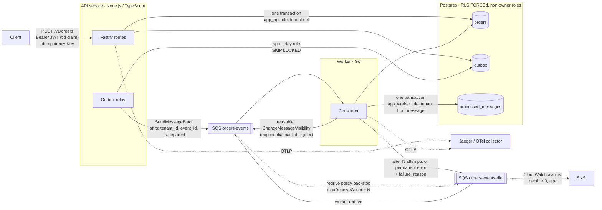

# multi-tenant-event-driven-ref

A small, finished reference for a multi-tenant, event-driven order pipeline:
a Node.js/TypeScript API, a Go worker, Postgres with row-level security, a
transactional outbox, SQS with a dead-letter queue, OpenTelemetry tracing
across the queue, and Terraform for AWS.

It is a clean-room implementation of patterns I have used in production,
written from scratch on a generic domain. It contains no employer code, names
or data, and none of its numbers are production numbers: everything under
[Results](#results-measured) was measured on a laptop and says so.

**The Terraform has never been applied.** It passes `fmt`, `validate`,
tflint and checkov; it has not created anything in any AWS account.

## Problem

A multi-tenant service that accepts orders over HTTP and processes them
asynchronously has to get four things right, and each one fails quietly:

1. **Tenant isolation.** One missing `WHERE tenant_id = ?` leaks data.
2. **No lost or phantom events.** Writing the order and publishing the event
   are two systems; a crash between them loses one or the other.
3. **Exactly-once effect on top of at-least-once delivery.** Clients retry
   timeouts; SQS redelivers. Neither may create or apply anything twice.
4. **Poison messages.** A message that can never succeed must not be retried
   forever, and whoever investigates it needs to know why it failed.

## Architecture



| Path | What happens |
|---|---|
| `POST /v1/orders` | Verifies the JWT and takes the tenant from its `tid` claim. In one transaction with `app.tenant_id` set: inserts the order (`ON CONFLICT (tenant_id, idempotency_key) DO NOTHING`) and an `order.created` outbox row carrying the request's `traceparent`. `201` new, `200 Idempotent-Replayed: true` for a retry, `422` for the same key with a different body. |
| Outbox relay | Runs inside each API process. Claims unpublished rows with `FOR UPDATE SKIP LOCKED`, sends them in batches of 10, marks them published. Continues the trace with a producer span. |
| Worker | Long-polls SQS. In one transaction with the message's tenant set: inserts `event_id` into `processed_messages` (duplicate → count and ack) and confirms the order. Failures back off via the visibility timeout; after `MAX_ATTEMPTS`, or immediately for a malformed message, it copies the message to the DLQ with `failure_reason` and deletes it. |
| `worker redrive` | Moves messages that were in the DLQ when it started back to the main queue. |

Code map: [`db/migrations/0001_init.sql`](db/migrations/0001_init.sql) (schema,
roles, policies), [`api/src`](api/src) (routes, idempotency, outbox, relay),
[`worker/internal`](worker/internal) (consumer, store, SQS),
[`infra/terraform`](infra/terraform), [`docs/adr`](docs/adr).

## Key decisions and trade-offs

Each has an ADR with the alternatives and when I would revisit it.

- **[Shared schema + Postgres RLS](docs/adr/0001-tenancy-model.md)**, not
  schema- or database-per-tenant. Policies are `FORCE`d, services connect as
  non-owner roles without `BYPASSRLS`, the tenant setting is
  transaction-local (`set_config(..., true)`), and unset means no rows. Each
  service has its own role: the API can't update or delete orders, the
  worker can't create them, the relay can't see them. The trade-off is
  shared capacity and harder per-tenant restore; a tenant that needs its own
  database moves to a silo tier behind the same code.
- **[At-least-once + idempotency + outbox](docs/adr/0002-queue-semantics.md)**,
  not FIFO or distributed transactions. Exactly-once *effect* comes from
  three cheap pieces: an `Idempotency-Key` at the edge, the outbox for the
  dual write, and a dedupe row committed with the side effect. Costs two
  extra writes per order and tables that need pruning.
- **[Retry in the worker, DLQ with a reason, SQS redrive as backstop](docs/adr/0003-retry-and-dlq-policy.md)**.
  Exponential backoff with jitter through `ChangeMessageVisibility`;
  permanent errors skip retries; the SQS redrive policy is set above the
  worker's limit so it only fires if the worker can't dead-letter itself.
- **Relay in the API process**, not a separate service or CDC. One fewer
  deployable; `SKIP LOCKED` makes it safe in every replica. Move to
  Debezium/logical replication when polling becomes the bottleneck.
- **Fargate, Spot for the worker.** Idempotent consumers make Spot
  interruptions harmless: in-flight messages reappear and are deduped.
- **Tokens are HS256 with a shared dev secret** so the repo is
  self-contained. The tenant still only ever comes from a verified claim.
  Production verifies an IdP's asymmetric tokens via JWKS.

## Failure modes

| Failure | What happens | Covered by |
|---|---|---|
| Query forgets the tenant filter | RLS returns only the current tenant's rows | `rls.test.ts`: unfiltered `SELECT` |
| No tenant set on a connection | Zero rows; inserts rejected | `rls.test.ts`: fails closed |
| Tenant setting leaks across pooled requests | Cannot: transaction-local, gone at commit/rollback | `rls.test.ts`: same connection after `COMMIT` and `ROLLBACK` |
| Token names a tenant that doesn't exist | `403 unknown_tenant` (foreign key), nothing written | `idempotency.test.ts` |
| Client retries a timed-out `POST` | Same order returned, one outbox event | `idempotency.test.ts`: 20 concurrent retries → one `201`, nineteen `200`, one event |
| Same key, different body | `422`, nothing written | unit + integration |
| API dies between order insert and publish | Outbox row is committed with the order; relay publishes it later | outbox design; relay test |
| Relay dies after send, before marking | Event sent again; worker dedupes | `TestDuplicateDeliveryAppliesOnce`, e2e duplicate delivery |
| SQS delivers twice / concurrently | `processed_messages` PK: applied once, `duplicate_deliveries` counted | `TestConcurrentDeliveriesApplyExactlyOnce` (16 goroutines) |
| SQS send fails (outage, IAM, wrong URL) | Rows stay unpublished, `publish_attempts` incremented, retried next pass; the error is logged on every pass; rows that keep failing are ordered last so they don't block newer ones | `relay.test.ts` |
| Relay can't publish for a long time | **Gap:** logged but not alarmed. The SQS alarms can't see rows still in the outbox; production should emit the age of the oldest unpublished outbox row as a metric and alarm on it | — |
| Transient DB error in the worker | Backoff via visibility timeout (base × 2^n, jittered), then success | `TestTransientFailureRetriesWithBackoffThenSucceeds` |
| Message names another tenant's order | RLS hides the order → retries → DLQ with `order not found in tenant`; the other tenant's order is untouched | `TestCrossTenantMessageIsRejectedAndLeavesNoTrace`, e2e, demo |
| Malformed message | DLQ on the first attempt with the parse error | `TestPermanentErrorsSkipRetries`, e2e |
| DLQ send fails | Message left on the main queue for SQS to redeliver | `TestDLQSendFailureLeavesMessageOnQueue` |
| Worker crash-loops on one message | SQS redrive policy (`maxReceiveCount` 8 > `MAX_ATTEMPTS` 5) moves it | Terraform precondition; LocalStack config |
| Redrive while the cause is unfixed | Message is dead-lettered again; redrive does not pick it up twice | `TestRedriveSkipsMessagesDeadLetteredAfterItStarted` |
| Redrive on a large DLQ | **Limitation:** redrive stops at the first batch that holds only messages dead-lettered after it started, so with sampling (short polls) it can stop early: run it again until it reports 0. It compares SQS's `SentTimestamp` with the worker's clock, so keep clocks in sync (NTP). For big DLQs, SQS's own `StartMessageMoveTask` is the better tool | — |
| Workers down or behind | `ApproximateAgeOfOldestMessage` alarm on the main queue | `infra/terraform/alarms.tf` |
| Dead letters ignored | DLQ depth > 0 and DLQ age alarms | `infra/terraform/alarms.tf` |

## Results (measured)

Measured with k6 against the docker compose stack on one laptop (Intel
i7-8550U, 4 cores / 8 threads, ~11 GB RAM), 60 s per rate, fresh stack per
run. Mix: 70% new orders, 10% idempotent retries, 20% reads. LocalStack
stands in for SQS, and k6 shares the CPU with everything it is testing, so
read these as the shape of the system, not as AWS capacity. Full output,
method and caveats: [`loadtest/results/`](loadtest/results/README.md).

| Target req/s | Achieved | Create p50 / p95 / p99 | HTTP errors | Create → confirmed p50 / p95 |
|---:|---:|---|---:|---|
| 100 | 100 | 3.4 / 4.7 / 7.7 ms | 0% | 148 / 219 ms |
| 300 | 300 | 4.3 / 14.5 / 88.2 ms | 0% | 233 / 338 ms |
| 450 | 450 | 9.0 / 151 / 454 ms | 0% | 10.3 / 14.9 s (backlog) |
| 600 | 543 (saturated) | 2.1 / 2.2 / 2.5 s | 0% | 7.1 / 15.4 s; 5,195 still queued |

Up to 300 req/s everything keeps up: orders are confirmed in 338 ms at p95
(p99 475 ms), much of it the relay's 200 ms idle poll. At 450 req/s the
API still answers quickly but the event path falls behind and drains after
the burst: the outbox absorbs the spike instead of failing requests. Part of
that backlog waits in the outbox, where the SQS queue-age alarm can't see it,
which is why an outbox-age alarm is listed as a gap below. The single Node.js process
saturates around 540 req/s. In mid-run `docker stats` samples the API,
Postgres and LocalStack were each near one core and the Go worker near 30%,
so the next step would be more API replicas (the relay is safe in each) and
a profile, not worker tuning.

Correctness under load: every check passed in every run (each replay
returned the original order id), and every order created at 100 to 450
req/s was confirmed.

Tests: 19 API unit tests, 15 API integration tests against Postgres and
LocalStack, 16 Go test functions (unit, Postgres, LocalStack), 7 end-to-end tests
through compose. Static: `terraform fmt -check`, `validate`, tflint with the
AWS ruleset and checkov pass (checkov with documented skips), and actionlint
passes on the workflow.

## Run it

Needs Docker with Compose v2. Nothing is installed on the host; every
toolchain runs in a container.

```sh
scripts/demo.sh        # build, start, and walk through the cases below (~1 min)
scripts/test.sh        # every test: API unit + integration, Go, end-to-end
scripts/lint.sh        # terraform fmt/validate, tflint, checkov, actionlint
loadtest/run.sh 300    # k6 at 300 requests/s for 60 s, results in loadtest/results/
docker compose down -v # stop and delete everything
```

The demo creates two tenants and shows: an order created and confirmed by
the worker; a retry with the same `Idempotency-Key` replayed; the same key
with a different body refused; the other tenant getting `404` for that
order; a duplicate SQS delivery absorbed; a poison message (routed as one
tenant, naming the other tenant's order) retried with backoff and
dead-lettered with its reason; a malformed message dead-lettered at once;
and a redrive. Abridged output from a run:

```text
== acme creates an order with an Idempotency-Key
   POST /v1/orders        201 pending total=3198
== The client retries the same request (same key, same body)
   POST /v1/orders        200 Idempotent-Replayed=true
   same order?            true
== The same key with a different body is refused
   POST /v1/orders        422 {"error":"idempotency_key_reused"}
== globex creates its own order; it cannot see acme's
   globex GET acme order  404 {"error":"not_found"}
== Outbox -> SQS -> Go worker confirms both orders
   acme order             confirmed after 196 ms
== SQS is at-least-once: deliver acme's event a second time
   duplicate deliveries   1 (recorded and skipped; the order was applied once)
== Poison message: routed as globex but naming acme's order
   dead-lettered after    8.6 s
   failure_reason         order not found in tenant
   failed_attempts        4
   acme order untouched   confirmed, processed_at unchanged: true
== Malformed message: dead-lettered on the first attempt (retrying cannot help)
   failed_attempts        1
== Redrive: move everything in the DLQ back to the main queue
moved 2 message(s) from the DLQ back to the queue
```

Traces are at <http://localhost:16686>: pick service `orders-api`, operation
`POST`, to see one trace spanning the HTTP request, the SQL, the outbox
publish and the worker's processing.

The API listens on `localhost:3000`. To call it by hand:

```sh
T=$(docker compose exec -T api node dist/cli.js create-tenant my-tenant)
TOKEN=$(docker compose exec -T -e JWT_SECRET=dev-only-signing-secret-do-not-use-anywhere-else api node dist/cli.js token "$T")
curl -s localhost:3000/v1/orders -H "authorization: Bearer $TOKEN" \
  -H 'idempotency-key: first-order' -H 'content-type: application/json' \
  -d '{"currency":"EUR","items":[{"sku":"A-1","quantity":2,"unit_price_cents":1250}]}'
```

### Deploying (not done)

`infra/terraform` describes the AWS deployment: SQS queue and DLQ with a
redrive policy, Aurora Serverless v2 (or one RDS instance, by variable), ECS
Fargate services behind an HTTPS ALB, per-service IAM roles, Secrets Manager
entries and CloudWatch alarms. A rough monthly cost with its assumptions and
levers is in [`docs/cost.md`](docs/cost.md): about **$109/month** as
configured, about **$65** in the cheapest sensible configuration. Both are
estimates from list prices, not a bill.

The order of operations would be: `terraform apply` with a certificate and
image URIs (see `terraform.tfvars.example`); create the four database roles
with generated passwords and write their connection strings and a JWT key to
the Secrets Manager entries (a one-off bootstrap script, not included); run
the migrate task definition; then the services start cleanly. I have not run
any of this.

## What production would add

- **Identity**: asymmetric JWTs from an IdP verified via JWKS, key rotation,
  per-tenant rate limits and quotas at the edge.
- **Database**: a bootstrap job that creates roles with rotated passwords
  (or IAM database auth), RDS Proxy, Multi-AZ, AWS Backup with cross-account
  copies, and pruning of published outbox rows and old dedupe rows (both grow
  without bound here).
- **Delivery**: CDC instead of polling past a few thousand events/s;
  lease-based outbox claims so the relay doesn't hold a transaction across
  the SQS call; a schema registry or versioned event contracts.
- **Operations**: worker autoscaling on queue age; a runbook for each alarm;
  DLQ triage tooling (filter by reason, redrive a subset); dashboards.
- **Security**: customer-managed KMS keys, WAF, ALB access logs, private
  subnets with VPC endpoints, image signing and scanning, SHA-pinned base
  images. Each skipped checkov check is listed with its reason in
  [`infra/terraform/.checkov.yaml`](infra/terraform/.checkov.yaml).
- **Delivery pipeline**: build and push multi-arch images, `terraform plan`
  on pull requests with OIDC credentials, a staged rollout.

## License

MIT, © 2026 Vishal Kumar. See [LICENSE](LICENSE).
